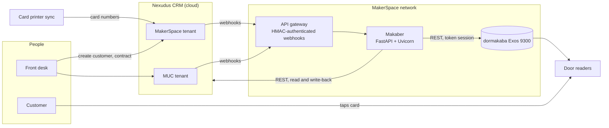
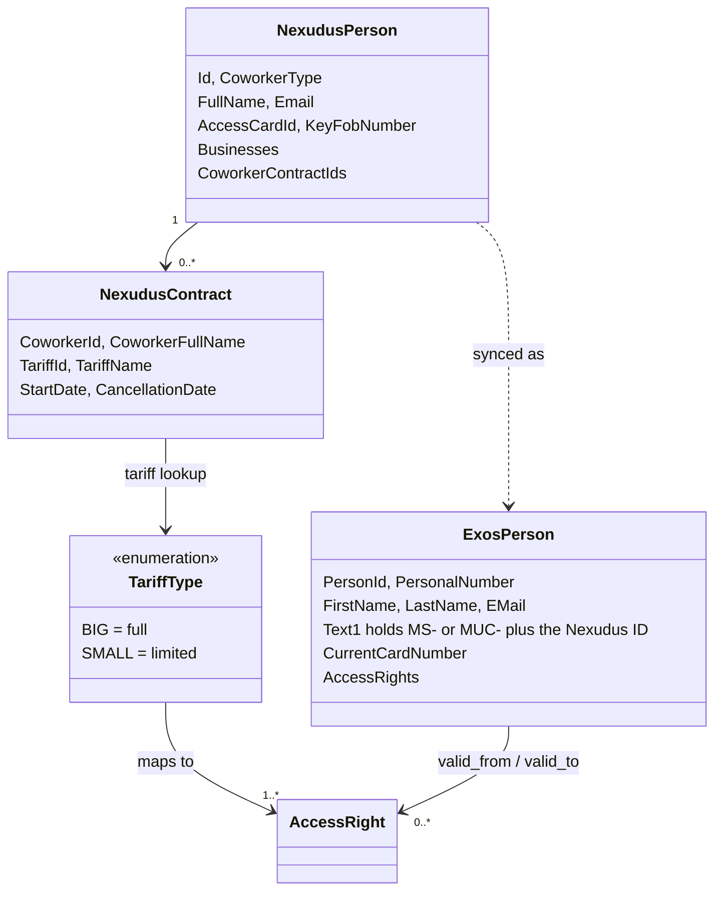
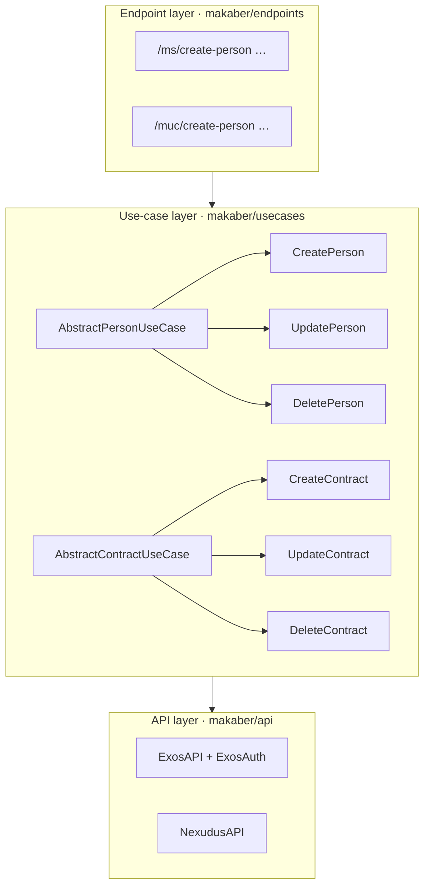
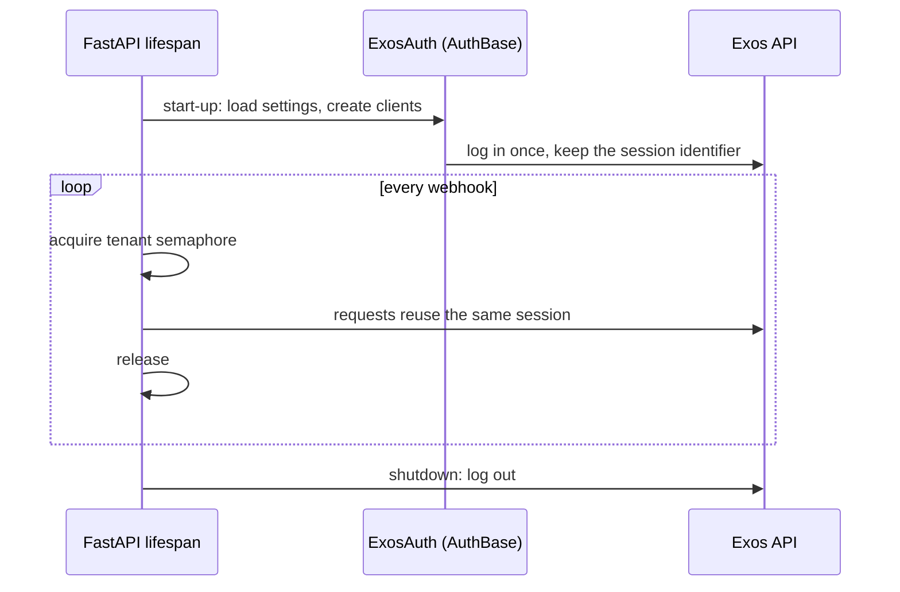

# Makaber: architecture

> [!NOTE]
> This architecture write-up was added by
> [Claude Opus 5.5](https://docs.anthropic.com/en/docs/claude-code) in Nov 2026 using my
> [agentic-repo-analysis](https://github.com/sp4ce-cowboy/agentic-workflows) skill, from the
> project's code, git history and documentation.

A technical write-up of Makaber, the integration between Nexudus and dormakaba at
UnternehmerTUM MakerSpace (Feb–Jul 2025). It draws on the source code (private, owned by
MakerSpace), its git history, the design docs and project log, and the staff user guide. Back to the [README](README.md).

**Contents:**
1. [Requirements](#1-requirements)
2. [System context](#2-system-context)
3. [Domain model](#3-domain-model)
4. [Layers](#4-layers)
5. [The use-case pipeline](#5-the-use-case-pipeline)
6. [Contracts and access rights](#6-contracts-and-access-rights)
7. [Who gets synced](#7-who-gets-synced)
8. [Sessions and concurrency](#8-sessions-and-concurrency)
9. [Resilience and observability](#9-resilience-and-observability)
10. [Security and deployment](#10-security-and-deployment)
11. [The migration](#11-the-migration)
12. [Staff tooling](#12-staff-tooling)
13. [Decisions and trade-offs](#13-decisions-and-trade-offs)
14. [Timeline](#14-timeline)
15. [Limits and next steps](#15-limits-and-next-steps)

## 1. Requirements

Gathered with the front-desk teams of MakerSpace and Munich Urban Colab (MUC), by
watching their workflows and asking questions. Their real pain points turned out to be
card-assignment conflicts, legacy users without IDs and odd contracts, more than the
formal brief of "automate access rights".

**Functional:**
- A new customer in Nexudus appears in dormakaba with no human step.
- Updates (name, email, card) and deletions propagate.
- Contracts drive access rights, bound to the contract's start and end dates.
- Works for two Nexudus tenants, MakerSpace and MUC, against one dormakaba system.

**Non-functional:**
- **System-independent:** loosely coupled, so moving to another CRM or access system
  changes as little as possible.
- **Resilient:** API downtime and expired tokens are handled without corrupting data.
- **Maintainable by whoever comes next:** structured, but not so abstract that a successor
  can't follow it.

## 2. System context



- **Nexudus** is the system of record for people, contracts and tariffs. It sends webhooks
  and offers a REST API.
- **dormakaba Exos 9300** holds persons, badges (cards) and access rights, behind a
  proprietary REST API with token sessions.
- **The card printer** writes new card numbers back into Nexudus (a separate system).
  Makaber picks them up from the person-updated webhook.

## 3. Domain model



- **The cross-system key.** Each synced Exos person stores the Nexudus ID with a tenant
  prefix in a free-text field (`Text1`). Makaber looks people up by that key, never by
  name, so older hand-made duplicates don't matter.
- All payloads are Pydantic models (`makaber/models/`). A webhook body is validated before
  any logic runs.

## 4. Layers

A version of Clean Architecture cut down to what a small middleware needs: three layers,
each with one job.



| Layer | Knows about | Doesn't know about |
|---|---|---|
| **Endpoints** parse the payload, apply exclusions, build the pipeline, return JSON | use cases, models | vendor APIs |
| **Use cases** hold one business operation each, and return `(Result, details)` | API clients, models | each other, HTTP |
| **API clients** handle authentication, requests, payload translation | vendor endpoints | business rules |

- Use cases share behaviour through abstract bases. For example, badge assignment
  lives in `AbstractPersonUseCase`, and tariff lookup and assignment checks live in
  `AbstractContractUseCase`.
- A concrete use case can be swapped for another without touching the rest.
- The rules follow the Single Responsibility and Open/Closed principles. Endpoints don't
  know about each other, and neither do use cases.

## 5. The use-case pipeline

The piece that makes the three layers work: `run_use_cases(factories)` in
`endpoint_helpers.py`. An endpoint declares a list of use-case factories. The runner
builds and runs each one in order and reads its `Result`:

| Result | Runner does |
|---|---|
| `PERSON_NOT_FOUND` | falls through to the next factory |
| any result, factory marked "swallow" | logs it and continues |
| `SUCCESS` / `FAILURE` | stops and returns a standard response |
| exception | stops and returns an error response |

So the update-person webhook is an **upsert plus contract sync**, written as data:

```python
factories = [
    (update_person, True),   # try to update; continue either way
    (create_person, True),   # create if they didn't exist yet
    make_update_contract,    # then bring access rights in line with the contract
]
return run_use_cases(factories)
```


Factories are lazy: a use case, and the API calls inside it, only runs if the pipeline
reaches it. For example, the contract is fetched only when the person has one.

## 6. Contracts and access rights

1. Look up the contract's tariff in Nexudus and map it to a tariff type (full or limited).
   An unknown tariff is logged and skipped, not failed.
2. Make sure the person exists in Exos.
3. Assign every access right of that tariff type, with `valid_from` = the contract start
   and `valid_to` = the end of day of the cancellation date.
4. **Verify:** read the rights back and check the dates match the contract
   (`_verify_assignments_assigned`).

Cancelling a contract ends the rights. Deleting a person removes them from Exos.
MUC customers get their base workspace rights automatically. Extra rooms are still
assigned by staff (user guide).

## 7. Who gets synced

Each tenant has exclusion rules (`is_excluded_makerspace_person` and the others), applied
before any use case runs:
- **Excluded:** guests, business accounts, and MakerSpace and UnternehmerTUM employees,
  whose special accesses stay manual.
- **Included:** members, and MUC employees.
- Nexudus tags are inconsistent, so only a clear member tag lets a MakerSpace person through.
- **MUC test mode:** MUC ran in test mode until 30 Apr 2025, then went live.

## 8. Sessions and concurrency



- **Why:** Exos allows at most six concurrent logins, and each script run used to count as
  a new one (403 errors). Makaber logs in once at start-up, through FastAPI's lifespan and
  a custom `requests` `AuthBase`, and reuses that session for its lifetime.
- **Bursts:** a single sign-up fires several webhooks within seconds (created, updated,
  contract). Each tenant's endpoints run behind an `asyncio.Semaphore(1)`. Events for one
  tenant are processed in order, with no races between create and update.
- **Staff commands** go through the running server (httpie examples in the README), so
  they don't add logins either.

## 9. Resilience and observability

- **Typed outcomes** (`Result` enum) instead of exceptions for expected cases: person not
  found, contract not found, retry, failure.
- **Logging:** a custom `Logger` over Python's `logging`. Every line carries the file and
  function it came from, so a chain of errors leaves a trace through the code. It has
  three levels (info, warn, error), coloured console output, and a log file.
- **Live operation:** after deployment, problems were debugged and fixed while the
  service stayed online. The system kept running through outages of the external APIs.

## 10. Security and deployment

| Stage | Setup |
|---|---|
| Development | Local Uvicorn plus an ngrok tunnel, with the tunnel URL set as the Nexudus webhook (README) |
| Production (Apr 2025) | Moved to MakerSpace's API server and run with Uvicorn; CI on GitHub Actions (pylint, pytest) |
| Hardening (Apr 2025) | With the infrastructure team: HMAC authentication on the webhooks and an API gateway in front, so customer data no longer passes through an open URL |

- Secrets live only in `.env`, loaded by `pydantic-settings` into one settings object per
  tenant (`Settings_MS`, `Settings_MUC`).
- The Exos API is reached only inside the MakerSpace network.

## 11. The migration

Before go-live, the existing customers in both systems had to be linked, with no shared
key between them.

1. Export all users from Nexudus and dormakaba to CSV.
2. Match them on names, emails and card numbers. Names use fuzzy matching
   (`fuzzywuzzy` token-sort ratio ≥ 80), to cope with swapped name order and spelling.
3. Write each Nexudus ID into the matched Exos person (`Text1`).
4. Re-apply access rights from the current contracts.

The script was one-off by design. It kept a file of successes so it could stop and resume
safely. Duplicate and orphaned records were cleaned up on the way.

## 12. Staff tooling

- **Terminal UI** (`scripts/main.py`, about 6,000 lines). It has 40 numbered commands over
  the Exos and Nexudus APIs: look up people, cards and access rights; assign or remove
  badges and rights; blacklist; reset day passes; bulk-create badges; find duplicates;
  merge CSV exports. It is written in a deliberately procedural style, which I called
  "Mind Your Business": every command is self-contained, so a broken API call breaks only
  its own command.
- **Day-pass reset tool** (`daypass_reset_app/`, Flask). Staff paste card numbers, choose
  1–7 days, and see results and warnings.
- **MUC check-in sync** (`scripts/exos_nexudus_checkin_script.py`), a long-running loop
  meant to run as a service.
- **User guides** in English and German, written for the front desk. They cover how to use
  it and a Q&A for every known failure case.
- **Diagrams** in PlantUML: the architecture and the use cases.

## 13. Decisions and trade-offs

| Decision | Alternatives | Why | Cost |
|---|---|---|---|
| Right-sized Clean Architecture | Full Clean Architecture or N-tier; everything inside the endpoints | "Too simple for N-tier, too complex for functions everywhere": successors must be able to read it | More files; some duplication between the MS and MUC endpoints |
| Pipeline of use cases driven by `Result` | Each endpoint hard-codes its branching | Multi-step flows become declarative and reorderable | One more concept for readers (documented in code) |
| One session plus per-tenant semaphores | Fully concurrent handling; a message queue | Fits the six-login cap and front-desk volume with no extra infrastructure | Webhooks for one tenant run one at a time |
| Nexudus ID stored in Exos | Match by name or email each time | Exact, stable lookups; immune to duplicates | Needed a one-off migration |
| Python, FastAPI, Requests | Flask; Node | Mature ecosystem for REST work; async; OpenAPI docs for free | — |
| Procedural staff TUI | Shared library behind the menu | Isolation: each command stands alone | Repetition, by design |

## 14. Timeline

From the project log.

| Weeks (2025) | Milestone |
|---|---|
| 3 Feb – 23 Feb | Onboarding; mapped Nexudus, dormakaba and the machine-access system, and the data flows between them |
| 24 Feb – 6 Mar | Kick-off; studied the Exos API; first sync module and the TUI |
| 7 Mar – 20 Mar | Logging, integration tests against Exos, async processing; weekly stakeholder reviews; webhook security planned with the infrastructure team |
| 21 Mar – 27 Mar | Demo to MakerSpace and MUC operations and leadership |
| 28 Mar – 4 Apr | Re-architecture into the layered design |
| 5 Apr – 20 Apr | Deployment to production, live end-to-end tests, monitoring; retrospective with the Director of Operations |
| 21 Apr – 4 May | Hand-over to infrastructure: API gateway with HMAC; MUC live 30 Apr |
| May – Jul | In production; maintained alongside [course-expiry](https://github.com/sp4ce-cowboy/course-expiry) |

## 15. Limits and next steps

- MUC customers' extra rights, staff accounts and ten-visit-card customers are still set
  by hand (user guide).
- The MS and MUC endpoints duplicate some code, which could be folded into one
  parameterised router.
- A fake Exos client would let the whole pipeline be tested end to end in CI.
- A retry queue for webhooks that fail while Exos is down would replace manual re-sync.
