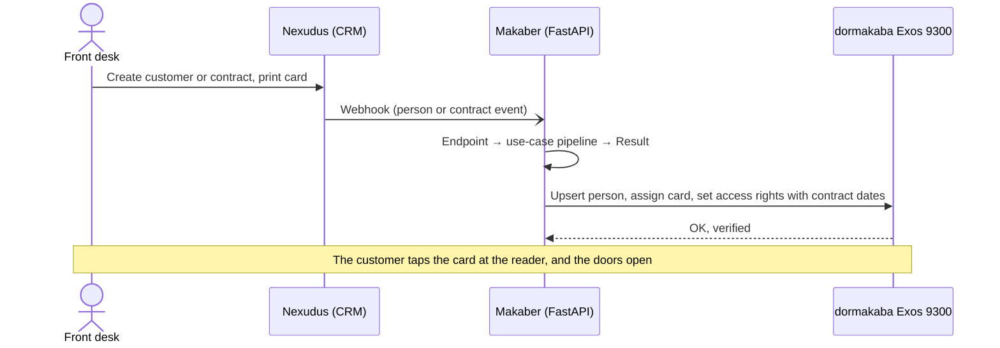
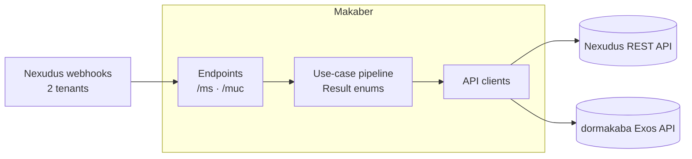

<div align="center">

# Makaber

**Customers created in the CRM open the right doors on their own.**<br>
Integration middleware that connects [Nexudus](https://nexudus.com) (customers and contracts) to a
[dormakaba Exos 9300](https://www.dormakaba.com) access-control system at
[UnternehmerTUM MakerSpace](https://www.maker-space.de) and Munich Urban Colab.

[](ARCHITECTURE.md#5-the-use-case-pipeline)
[](ARCHITECTURE.md#4-layers)
[](ARCHITECTURE.md#10-security-and-deployment)
[](ARCHITECTURE.md#3-domain-model)
[](ARCHITECTURE.md#8-sessions-and-concurrency)
[](ARCHITECTURE.md#12-staff-tooling)
[](ARCHITECTURE.md#10-security-and-deployment)
[](ARCHITECTURE.md#10-security-and-deployment)
[](ARCHITECTURE.md#12-staff-tooling)


[](https://wakatime.com)


</div>

> [!NOTE]
> This consolidated README page was added by
> [Claude Opus 5.5](https://docs.anthropic.com/en/docs/claude-code) in Nov 2026 using my
> [agentic-repo-analysis](https://github.com/sp4ce-cowboy/agentic-workflows) skill, from the
> project's code, git history and documentation. The project itself is from Feb – Jul 2025. The
> source code is private: it belongs to UnternehmerTUM MakerSpace. The full technical write-up is in
> **[ARCHITECTURE.md](ARCHITECTURE.md)**.

## At a glance

| | |
|---|---|
| **What** | A Python service that keeps the door-access system in sync with the customer database, for two sites: MakerSpace and Munich Urban Colab (MUC) |
| **Where** | UnternehmerTUM MakerSpace GmbH, Garching (Munich), Operations & IT |
| **Context** | Software engineering intern (Praktikant), [NUS Overseas Colleges](https://enterprise.nus.edu.sg/education-programmes/nus-overseas-colleges/) Munich, Feb–Jul 2025 |
| **My role** | Lead developer, end to end: requirements with the front desk, architecture, code, data migration, deployment, docs and hand-over |
| **Status** | In production at both sites since April 2025 |

## The problem

MakerSpace keeps its customers and contracts in Nexudus, a coworking CRM, and its doors in
dormakaba. The two never talked. For every new customer, card change or new contract,
the front desk had to open dormakaba and enter the person, their card and their access
rights by hand. This was slow, error-prone, and left duplicate and orphaned records.

| Before | After |
|---|---|
| Every customer typed into dormakaba by hand | Created in dormakaba automatically, about 30 s after sign-up |
| Card numbers and access rights set by hand | Card and date-bound access rights follow the contract |
| Records drift apart; duplicates and orphans pile up | Name, email and card changes sync on every update; legacy records linked once by migration |
| Front desk works in two systems | MakerSpace customers: print the card, hand it over, done (about 90% less access admin) |

## How it works



Six webhooks drive it: a person is created, updated or deleted; a contract is created,
updated or cancelled.

## Architecture in brief



- **A right-sized Clean Architecture.** Endpoints parse and filter, use cases hold the
  business rules, and API clients hide each vendor. Swapping the CRM or the access system
  touches one layer.
- **A use-case pipeline.** Each use case returns a typed `Result`, and a small runner
  chains them. So "update the person, or create them if missing, then sync their contract"
  is one declarative list.
- **Built for the vendor's limits.** One long-lived authenticated session, and per-tenant
  `asyncio` semaphores, keep bursts of webhooks inside dormakaba's cap of six concurrent
  logins.
- **A stable cross-system key.** Every synced dormakaba record carries its Nexudus ID.
  A one-off migration with fuzzy matching linked all existing records.

More in [ARCHITECTURE.md](ARCHITECTURE.md): the domain model, the pipeline semantics,
access-right logic, concurrency, resilience, security, the migration, and the decisions
and their trade-offs.

## Skills covered

| Skill | How it's shown | Docs |
|---|---|---|
| **Async web services**<br> | Six webhook endpoints per tenant (MakerSpace and MUC) on FastAPI routers. An app lifespan opens the dormakaba session and builds the API clients at start-up, and closes them at shutdown. | [FastAPI](https://fastapi.tiangolo.com) |
| **API integration & webhooks**<br> | Nexudus webhooks drive calls to two vendor REST APIs, through one client class per vendor that wraps authentication, session reuse and payload translation. | [Requests](https://requests.readthedocs.io) |
| **Software architecture** | A right-sized Clean Architecture: endpoints, use cases returning typed `Result` enums, and API clients. A small pipeline runner turns multi-step flows into declarative lists. | [Clean Architecture](https://blog.cleancoder.com/uncle-bob/2012/08/13/the-clean-architecture.html) |
| **Concurrency control**<br> | Per-tenant semaphores serialize bursts of webhooks, so the create, update and contract events for one person never race. | [asyncio](https://docs.python.org/3/library/asyncio-sync.html#semaphore) |
| **Authentication & sessions** | A custom `requests` `AuthBase` holds one long-lived Exos session, which keeps the service within the vendor's cap of six concurrent logins. | [Custom auth](https://requests.readthedocs.io/en/latest/user/advanced/#custom-authentication) |
| **Typed models & settings**<br> | Every webhook payload is validated into a Pydantic model before any logic runs, and secrets load per tenant through pydantic-settings. | [Pydantic](https://docs.pydantic.dev) |
| **Data migration** | Linked two unlinked systems once, from CSV exports, by fuzzy name matching (token-sort ratio ≥ 80) plus emails and card numbers. The run could resume from a file of successes. | [thefuzz](https://github.com/seatgeek/thefuzz) |
| **Observability** | A custom logger tags every line with its file and function, so a chain of errors leaves a trace through the code. | [logging](https://docs.python.org/3/library/logging.html) |
| **CLI design** | A 40-command terminal UI over the dormakaba and Nexudus APIs, for staff and debugging. Each command is isolated by design. | — |
| **Internal tools**<br> | A small web page where staff paste card numbers and reset day passes 1–7 days ahead. | [Flask](https://flask.palletsprojects.com) |
| **Team workflow & CI**<br> | Feature branches, 9 merged pull requests, and pylint and pytest on every push. | [GitHub Actions](https://docs.github.com/actions) |
| **Documentation**<br> | User guides in English and German for the front desk, PlantUML architecture and use-case diagrams, and developer notes in the code. | [PlantUML](https://plantuml.com) |

## Outcome

- In production at MakerSpace and Munich Urban Colab since April 2025.
- About 90% less access-management work for the front desk, and door access about 30
  seconds after sign-up.
- Duplicate and orphaned access records eliminated by the migration. The system kept
  running through outages of the external APIs.
- MakerSpace's reference letter (Arbeitszeugnis, July 2025) names it one of two key
  achievements:

> *„Die erfolgreiche Integration des ERP-Systems mit dem Türzugangssystem zur automatischen Kunden-Zugangsverwaltung."*<br>
> The successful integration of the ERP system with the door-access system for automatic customer access management.

The other highlight is [course-expiry](https://github.com/sp4ce-cowboy/course-expiry).

## Coding stats

From [WakaTime](https://wakatime.com) and git, outside the `archive/` folder.

| | |
|---|---|
| **Time** | **142 h** of coding, over 73 days |
| **Period** | 25 Feb – 2 Jul 2025, with commits on 51 days |
| **Peak week** | **26.4 h** (7 – 13 Apr 2025, the production deployment) |
| **Peak day** | **8.2 h** (Mon 7 Apr 2025) |
| **Longest push** | **16.2 h** without a break longer than 3 h (Thu 10 Apr 16:43 → Fri 11 Apr 08:53), 8.5 h of it coding |
| **Commits** | **615** across 18 branches, and 9 merged pull requests |
| **Code** | about **13,500** lines: 12,400 Python, plus Markdown, HTML and PlantUML |

```text
Hours per week (2025)                  Commits per month
24 Feb  █████                   6.5    2025-02  █                    22
03 Mar  ██████████             12.9    2025-03  ██████████          205
10 Mar  ████████████           15.9    2025-04  ████████████████    339
17 Mar  ██████                  7.5    2025-05  ██                   40
24 Mar  █████                   6.9    2025-06                        0
31 Mar  ██████████             13.7    2025-07  █                     9
07 Apr  ████████████████████   26.4
14 Apr  ██████████████         19.1
21 Apr  ████████████           15.9
28 Apr  █████                   6.9
05 May  █████                   6.5
```

After go-live in May, the service ran in production with about 4 h of maintenance to July.

## On my resume

**Skills:** Python · FastAPI · asyncio · REST APIs and webhooks · Pydantic · Clean Architecture · API integration · authentication and sessions · data migration · Flask · CI/CD (GitHub Actions, pytest, pylint) · technical writing

- Architected and shipped Makaber, a Python 3.10 / FastAPI integration middleware that syncs a Nexudus CRM with a dormakaba Exos 9300 access-control system for 2 sites (MakerSpace and Munich Urban Colab) through 6 webhook-driven use cases per site, cutting front-desk access administration by ~90% and opening doors for new members ~30 s after sign-up.
- Designed a right-sized Clean Architecture (endpoints → use cases → API clients) with a declarative use-case pipeline: each use case returns a typed `Result` enum, and a runner chains lazily built factories, so a multi-step upsert plus contract sync is a 3-line list and either vendor system stays swappable behind its client layer.
- Kept the service within the vendor API's 6-concurrent-login cap, which had been causing 403 errors, by holding one long-lived Exos session (a custom `requests` AuthBase opened in FastAPI's lifespan) and serializing webhook bursts with per-tenant `asyncio.Semaphore`s, so create, update and contract events for one person never race.
- Turned CRM contracts into door access automatically: tariffs map to sets of access rights, assigned with validity windows bound to the contract's start and cancellation dates, then read back and verified against the contract; unknown tariffs are logged and skipped rather than failing the sync.
- Validated every webhook payload into Pydantic v2 models before any business logic ran, loaded per-tenant secrets through pydantic-settings, and worked with the infrastructure team to move the webhooks behind an API gateway with HMAC authentication for production.
- Linked the legacy records of two systems with no shared key through a resumable migration: fuzzy matching on names (token-sort ratio ≥ 80), emails and card numbers, writing a tenant-prefixed Nexudus ID into each Exos person as a stable cross-system key, and clearing duplicate and orphaned records before go-live.
- Built the staff tooling: a 40-command terminal UI (~6,000 lines of Python) over both vendor APIs, a Flask day-pass reset tool, and English and German user guides with a Q&A for every known failure case.
- Took the project from requirements to production in 5 months: requirements gathered with two front-desk teams, a demo to operations leadership, a production deployment with live end-to-end tests, and 9 merged pull requests with pylint and pytest in GitHub Actions CI.
